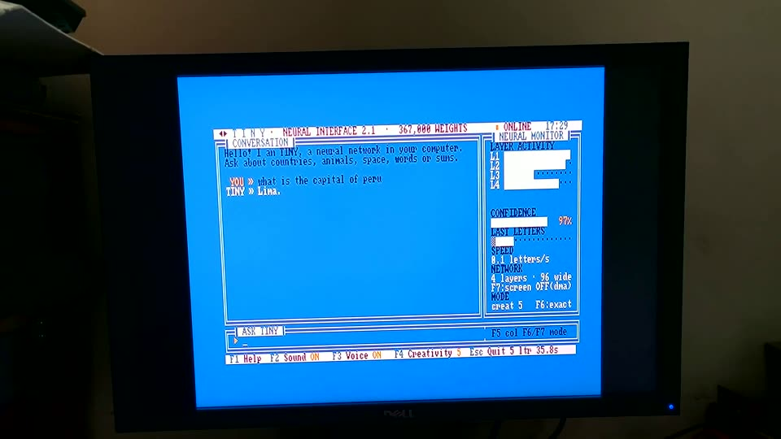
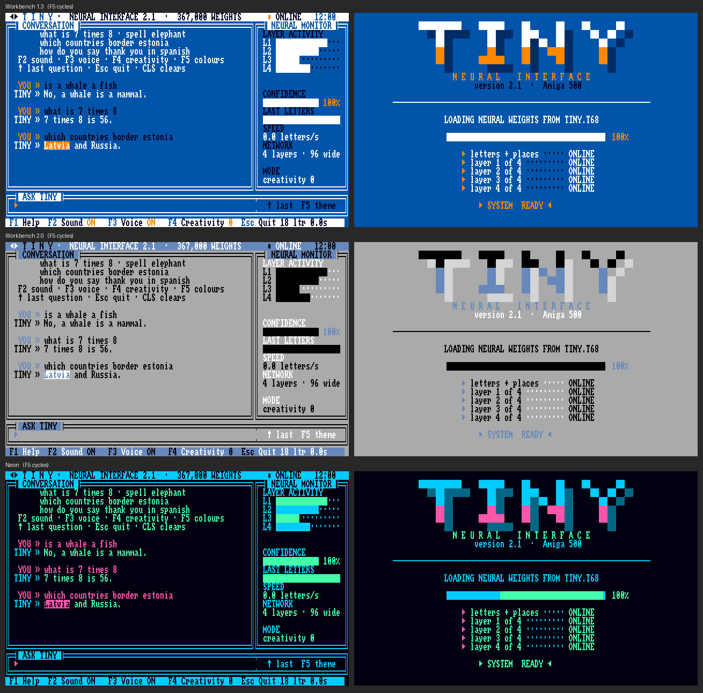

# tiny68k: TINY 2.1 on an Amiga 500

**tiny68k is a port of [TINY 2.1](https://github.com/WollyMonjac/Tiny-2.1)
by [WollyMonjac](https://github.com/WollyMonjac).** TINY 2.1 is a
367,000-parameter transformer that answers questions letter by letter. It was
written for DOS and Turbo C with floating point, and it fits on a floppy disk.
The model, its weights, its training and its interface design are
WollyMonjac's work. This repository only brings them to a 7.09 MHz 68000 with
no FPU, in integer arithmetic, on a stock Amiga 500 with Kickstart 1.2.

[](video/tiny68k_a500_60s.mp4)

`video/tiny68k_a500_60s.mp4`: one minute on a real A500. The sped-up parts
are marked on screen. In real time, "Lima." took 35.8 s with the screen off
while it thinks, and "I am a tiny neural network." took 67.4 s with the
screen on (both figures are from the program's own status line).

## Status

1. **Done**: float reference, `.t68` converter, integer specification
   (`oracle_tiny.py`), accuracy gate. 44/44 greedy answers identical to TINY.C.
2. **Done**: the C engine (`src/tiny68k.c`) and the bit-exactness gate.
3. **Done**: the 68000 build with vbcc, checked in an emulated 68000 against
   the specification, and run on Kickstart 1.2. Three optimisation rounds in
   68000 assembly took "what is the capital of peru" from 130 s to 77 s
   (cycle-exact WinUAE).
4. **In progress**: TINY.C's interface on the A500 (hires, three themes on
   F5, neural monitor), a fast prefill mode and a prefix cache. Sound is a
   stub. See `docs/GUI.md`.



`AGENTS.md` has the full rules, measurements and history.

## Setup

TINY 2.1 has no licence file, so its source and `TINY.BIN` are not in this
repository. Get them from the upstream repository (the commit is in
`orig/UPSTREAM_COMMIT`): copy `TINY.C`, `TINY.BIN` and `README.TXT` into
`orig/`, then:

```
python build.py ref        # the original TINY.C as a host tool
python build.py convert    # TINY.BIN -> tiny.t68
python build.py check      # float reference = TINY.C; integer oracle ~ float
python build.py verify     # C engine == integer oracle, bit for bit
python build.py amiga      # 68000 executable (vbcc +kick13, vasm) -> build/tiny68k
python build.py gate       # vbcc-compiled 68000 code == oracle, in Musashi
python build.py gui        # the Amiga interface -> build/tinygui
```

`src/prefix_kv.h` is generated from TINY.BIN's weights (a key/value cache
for common question openings) and is checked in so the engine builds.

## Layout

| Path | What |
|---|---|
| `oracle_tiny.py`, `fx.py` | **the specification**: integer forward pass, Q16.16 primitives |
| `ref_tiny.py`, `convert_tiny.py` | float reference and TINY.BIN reader; TINY.BIN -> `tiny.t68` |
| `check_ref.py`, `cmp_fp32.py` | stage 1 gates |
| `src/` | the engine (`tiny68k.c`, `matmul68k.s`) and the Amiga interface |
| `scripts/` | `verify.py`, `m68k_gate.py`, `asm_unit.py`, profilers, experiments |
| `emu/` | WinUAE tests on Kickstart 1.2 |
| `intro/` | a standalone boot intro test |
| `ref/` | harness around the unmodified TINY.C, its answers |
| `docs/` | `GUI.md` and screenshots |
| `video/` | the A500 video and the script that cut it |
| `build/` | everything compiled (not in git) |

## The model

From the TINY.BIN header: D=96, 4 layers, 4 heads of 24, ReLU feed-forward
of 256, learned positions (128), 97 letters, output layer tied to the
embedding. Weights are int8 with one scale per row; the key/value cache is int8
with one scale per vector.

## How the integer version works

- Weights stay int8, bit for bit. Each float row scale becomes a 16-bit
  mantissa and a shift.
- Activations are Q16.16 and enter each matmul as **int16** with a
  power-of-two shift. The 68000's MULS is 16x16 anyway, so this costs the same
  as int8 and keeps about 14 bits.
- RMSNorm squares `x >> k`, because the residual stream reaches 170 and
  170² does not fit Q16.16.
- The key/value cache uses the same int8 absmax rounding as TINY.C. Attention
  scores are int8·int16 dot products rescaled by a per-position (mantissa,
  shift), so all of attention runs through the same kernel as the matmuls.
- exp comes from a table in the model file, and `1/sqrt(24)` is a header
  constant.
- On the 68000 the big matmuls use bit-plane lookup tables (T-MAC) instead of
  MULS. The arithmetic stays exact, so the scores do not change.

## Accuracy

Over 44 questions and 772 answer positions with teacher forcing, compared to
float:

| | |
|---|---|
| logit correlation | min 0.99987, mean 0.99998 |
| top-10 overlap | min 9/10, mean 9.96/10 |
| argmax agreement | 772/772 |
| greedy answers identical to TINY.C | 44/44 |

## How it was made

Built with [Claude Code](https://claude.com/claude-code). Claude wrote the
float reference, the integer specification, the C engine, the 68000
assembly, the Amiga interface, the test gates and the emulator harnesses;
the author directed the work and ran it on a real Amiga 500. The method that
kept it correct is in `AGENTS.md`: a Python integer specification first, then
every C or assembly change checked bit for bit against it (gcc on the host,
vbcc code in an emulated 68000, the real executables in WinUAE on
Kickstart 1.2).

## Credits

- **TINY 2.1**: [WollyMonjac](https://github.com/WollyMonjac),
  <https://github.com/WollyMonjac/Tiny-2.1>. Model, weights, training and the
  original DOS program.
- Amiga port, integer arithmetic and 68000 code: this repository.
